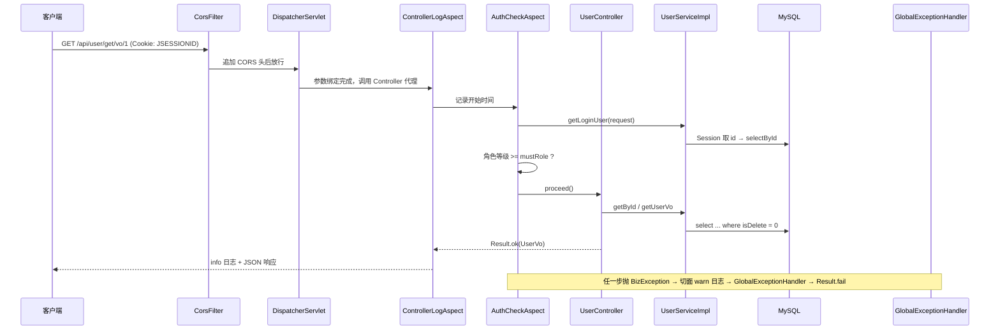

# 项目讲解：从一次请求到 AI 生成代码的完整链路

> 本文件用一条业务主线串起项目**现有**功能，适合讲解、复盘与新人上手。
> 类的字段、配置项、依赖版本等细节以 [file-class-reference.md](file-class-reference.md) 为准，踩坑原因见 [pitfalls.md](pitfalls.md)。
> **维护约定**：与 [changelog.md](changelog.md) / [file-class-reference.md](file-class-reference.md) / [pitfalls.md](pitfalls.md) 同步维护，**有新增才更新，没有新增不更新**（也不改「最后更新」日期）。
> - 需要更新：新增 / 变更接口端点、新业务链路或主线环节打通（如 5.2 中的项）、鉴权规则变化、新增支撑能力、第七节问题被修复或新发现
> - 不更新：仅类内部细节、依赖版本、配置项微调、纯排错记录——这些只改其他三份文档
>
> 最后更新：2026-11-19

## 一、一句话说明

`zh-ai-code-mpther` 是一个 **AI 零代码应用生成平台** 的后端：用户注册登录后，用自然语言描述需求，由大模型生成 HTML / 多文件网站代码。
目前已完成「用户体系 + 权限 + 统一请求处理 + 应用管理 + AI 代码生成能力」，**AI 能力尚未通过 HTTP 接口对外开放**（见第五节）。

| 维度 | 现状 |
|---|---|
| 技术栈 | JDK 21、Spring Boot 4.1.2、MyBatis-Flex 1.11.8、MySQL、LangChain4j 1.23.0（DeepSeek）、Knife4j |
| 访问入口 | `http://localhost:8123/api`，接口文档 `http://localhost:8123/api/doc.html` |
| 数据库 | `zh_ai_code_mother`，三张表 `user` / `app` / `chat_history`（`sql/create_table.sql`，列名驼峰） |
| 配置 | `application.yml`（`spring.profiles.active: local`）+ `application-local.yml`（DeepSeek 配置，不入库） |

## 二、分层结构

```
浏览器 / Knife4j
   │  HTTP（携带 JSESSIONID Cookie）
   ▼
┌──────────────────────────── 横切层 ────────────────────────────┐
│ CorsFilter（最高优先级）→ DispatcherServlet → 参数绑定/校验     │
│ ControllerLogAspect @Order(1) → AuthCheckAspect @Order(2)       │
│ GlobalExceptionHandler（异常 → Result）                          │
└─────────────────────────────────────────────────────────────────┘
   ▼
controller/   接收参数、调用 Service、包装 Result
   ▼
service/      业务校验、密码加密、Session 登录态、实体 → VO 脱敏
   ▼
mapper/       MyBatis-Flex BaseMapper（自动逻辑删除 isDelete）
   ▼
MySQL zh_ai_code_mother

ai/           AiCodeGeneratorService（LangChain4j 代理）→ DeepSeek API
```

| 层 | 关键类 | 一句话职责 |
|---|---|---|
| 横切 | `CorsConfig` | 所有响应（含 404 / 异常）都带 CORS 头 |
| 横切 | `ControllerLogAspect` | 记录 URI、参数（密码脱敏）、返回值、耗时 |
| 横切 | `AuthCheck` + `AuthCheckAspect` | 注解式登录 / 角色校验 |
| 横切 | `GlobalExceptionHandler` + `ErrorCode` + `BizException` + `ThrowUtils` | 异常统一转为 `Result` |
| 公共 | `Result` / `PageQuery` / `PageResult` / `DeleteRequest` | 统一响应、分页、删除入参 |
| 业务 | `UserController` → `UserServiceImpl` → `UserMapper` | 注册、登录、登录态、注销、用户查询 |
| 业务 | `AppController` → `AppServiceImpl` → `AppMapper` | 应用创建、归属校验、精选 / 我的 / 管理员分页、`AppVo` 附带创建者 |
| AI | `AiCodeGeneratorServiceFactory` → `AiCodeGeneratorService` → `HtmlCodeResult` / `MultiFileCodeResult` | 调 DeepSeek 生成代码，结果解析为 POJO |
| AI | `AiCodeGeneratorFacade` → `CodeFileSaver` | 门面按类型调用生成并落盘到 `tmp/code_output/{bizType}_{雪花ID}/` |
| 工具 | `MyBatisFlexGenerator` | 按表生成 entity / mapper / service / controller 骨架 |

## 三、通用请求链路（所有接口都会经过）

以「普通用户访问 `GET /api/user/get/vo/{id}`」为例：



| 步骤 | 位置 | 做什么 | 失败时 |
|---|---|---|---|
| 1 | `CorsFilter` | 按 `zh.cors.*` 写 CORS 响应头；预检 `OPTIONS` 直接返回 | — |
| 2 | `DispatcherServlet` | 路由到 Controller，绑定并校验参数（`@Valid`） | 校验失败 → `40000`，此时**未进入切面**，无切面日志 |
| 3 | `ControllerLogAspect` | 最外层环绕，记录 `[GET /api/...] 类#方法 \| 参数 \| 返回 \| 耗时` | 记录 `warn` 后原样抛出 |
| 4 | `AuthCheckAspect` | 仅对标注 `@AuthCheck` 的方法 / 类生效：取登录用户 → 比较角色等级 | 未登录 `40100`；权限不足 `40300` |
| 5 | Controller | 参数兜底校验（`ThrowUtils.throwIf`），调用 Service，返回 `Result.ok(...)` | 抛 `BizException` |
| 6 | Service | 业务规则、加密、Session、VO 转换 | 抛 `BizException` |
| 7 | Mapper | MyBatis-Flex 生成 SQL，自动追加 `isDelete = 0` | 底层异常 → 兜底 `50000` |
| 8 | 响应 | Jackson 3 序列化为 `{code, message, data, success}` | — |
| 异常 | `GlobalExceptionHandler` | 按异常类型取 `ErrorCode`，生成 `Result.fail(...)` | 兜底分支只返回通用文案，堆栈进日志 |

**响应约定**：成功 HTTP 200 + `code: 0`；失败当前**一律 HTTP 400**，具体原因看 `code`（`ErrorCode` 为 5 位码，`HttpStatus.resolve` 反查不到，见 pitfalls P-16）。

## 四、业务主线：注册 → 登录 → 鉴权访问 → 注销

### 4.1 用户注册 `POST /api/user/register`

请求体 `UserRegisterRequest`：`{"userAccount","userPassword","checkPassword"}`，无需登录。

| 序号 | 位置 | 处理 | 失败返回 |
|---|---|---|---|
| 1 | `UserController#register` | 请求体为 null 拦截 | `40000 用户信息不能为空` |
| 2 | `UserServiceImpl#register` | 三个参数非空 | `40000 参数为空` |
| 3 | 同上 | 两次密码一致 | `40000 两次密码不一致` |
| 4 | 同上 | 密码 8~16 位、账号 4~16 位 | `40000` |
| 5 | 同上 | `QueryWrapper.eq(User::getUserAccount, ...)` 查重（用 Lambda 取列名，避免 P-22） | `11001 用户名已存在` |
| 6 | `encryptPassword` | `MD5(密码 + 固定盐 "zhang")` | — |
| 7 | 同上 | 默认 `userName = userAccount`、`userRole = "user"`，`save`；主键由雪花算法生成 | `50000 注册失败` |
| 8 | 返回 | `Result<Long>`，`data` 为新用户 id | — |

### 4.2 用户登录 `POST /api/user/login`

请求体同注册（只用 `userAccount` / `userPassword`）。

| 序号 | 处理 | 失败返回 |
|---|---|---|
| 1 | 参数非空、长度校验 | `40000` |
| 2 | 密码按注册时同样规则加密 | — |
| 3 | 按「账号 + 密文」查一条用户（已逻辑删除的用户查不到） | `11002 用户不存在`（账号不存在与密码错误都走这里） |
| 4 | `request.getSession().setAttribute("user_login", user)`，Tomcat 下发 `JSESSIONID` Cookie | — |
| 5 | `loginUserVo(user)` 脱敏后返回 `Result<LonginUserVo>`（不含密码、`isDelete`） | — |

**登录态的本质**：服务端 Session 中保存 `User` 实体，客户端只持有 `JSESSIONID`。后续请求带上 Cookie 即视为已登录。

### 4.3 获取当前登录用户 `GET /api/user/get/login`

`UserServiceImpl#getLoginUser` 是**全项目共用的登录态入口**（`AuthCheckAspect` 也调它）：

1. 从 Session 取 `user_login`，为空或无 id → `40100 用户未登录`
2. 按 id **重新查库**（不直接信任 Session 中的旧数据）→ 查不到同样 `40100`
3. 返回最新 `User` 实体；Controller 再经 `loginUserVo` 脱敏

因此管理员修改某用户角色后，该用户**无需重新登录**，下一次请求即按新角色鉴权。

### 4.4 鉴权访问：`@AuthCheck` 与角色等级

| 注解写法 | 含义 | 当前使用位置 |
|---|---|---|
| 无注解 | 匿名可访问 | `register` / `login` / `get/login` / `logout`、Demo、Health、`/chatHistory/*` |
| `@AuthCheck` | 登录即可（默认 `mustRole = USER`） | `GET /user/get/vo/{id}`、`GET /user/list/page/vo`、`/app` 下非 `admin/` 的 6 个接口 |
| `@AuthCheck(mustRole = ADMIN)` | 仅管理员 | `/user/save`、`remove/{id}`、`update`、`list`、`getInfo/{id}`、`page`；`/app/admin/*` 4 个接口 |

判定规则（`UserRoleEnum`）：`USER=10`、`ADMIN=100`，**用户等级 ≥ 要求等级即放行**；数据库里出现未知角色值一律拒绝。

| 访问者 | `get/vo/{id}` | `list`（ADMIN） |
|---|---|---|
| 未登录 | `40100` | `40100` |
| 普通用户 | 200 | `40300` |
| 管理员 | 200 | 200 |

脱敏查询的数据流：`userService.page(Page.of(pageNum, pageSize))` → `getUserVoList` 只复制 `UserVo` 字段 → `PageResult.of(list, total, query)` → `Result.ok`。

### 4.5 用户注销 `POST /api/user/logout`

1. Session 中没有 `user_login` → `10003 用户未登录`（注意：这里用的是 `OPERATION_NOT_ALLOWED`，不是 `40100`）
2. `removeAttribute("user_login")`，返回 `Result<Boolean>` `true`
3. 之后再访问 `@AuthCheck` 接口 → `40100`

### 4.6 端到端演示脚本（PowerShell）

先在 IDEA 启动应用，然后依次执行（`$s` 保存 Session Cookie）：

```powershell
$base = 'http://localhost:8123/api'
$body = @{ userAccount = 'demo0001'; userPassword = '12345678'; checkPassword = '12345678' } | ConvertTo-Json
$json = @{ ContentType = 'application/json'; Body = $body }

# 1. 注册（重复执行会得到 11001）
Invoke-RestMethod -Method Post "$base/user/register" @json
# 2. 登录，-SessionVariable 保存 JSESSIONID
Invoke-RestMethod -Method Post "$base/user/login" @json -SessionVariable s
# 3. 当前登录用户
Invoke-RestMethod "$base/user/get/login" -WebSession $s
# 4. 登录即可访问：脱敏分页
Invoke-RestMethod "$base/user/list/page/vo?pageNum=1&pageSize=5" -WebSession $s
# 5. 管理员接口：普通用户会收到 HTTP 400 + 40300（PowerShell 表现为抛异常）
Invoke-RestMethod "$base/user/list" -WebSession $s
# 6. 注销，之后再执行第 4 步得到 40100
Invoke-RestMethod -Method Post "$base/user/logout" -WebSession $s
```

把某用户设为管理员：数据库执行 `update user set userRole = 'admin' where userAccount = 'demo0001';`，无需重新登录。

### 4.7 应用管理 `/api/app/*`

登录后用户围绕「自己的应用」操作，管理员用 `admin/` 前缀接口管理任意应用：

| 动作 | 用户接口（`@AuthCheck`） | 管理员接口（ADMIN） |
|---|---|---|
| 创建 | `POST /app/add`，`{"initPrompt"}` 必填 | — |
| 修改 | `PUT /app/update`，只改 `appName`，仅本人 | `PUT /app/admin/update`，`appName` / `cover` / `priority` |
| 删除 | `DELETE /app/delete/{id}`，仅本人 | `DELETE /app/admin/delete/{id}`，任意应用 |
| 详情 | `GET /app/get/vo/{id}` | `GET /app/admin/get/vo/{id}` |
| 分页 | `GET /app/my/list/page/vo`（自己的）、`GET /app/good/list/page/vo`（精选），只按 `appName` 查，每页 ≤ 20 | `GET /app/admin/list/page/vo`，除时间外任意字段，每页 ≤ 100（`PageQuery` 上限） |

1. **创建**：`AppServiceImpl#createApp` 校验 `initPrompt` 非空 → `appName` 取 prompt 前 12 字、`codeGenType = multi_file`、`priority = 0`、
   `userId = 当前用户` → `save`，返回雪花 id
2. **归属校验**：用户修改 / 删除先查应用（不存在 `10001`），再比较 `app.userId` 与登录用户 id（不一致 `40300 只能操作自己的应用`）；
   管理员接口不做归属校验
3. **精选**：`priority = AppConstant.GOOD_APP_PRIORITY`（99）即为精选，由管理员通过 `admin/update` 设置
4. **查询**：`AppServiceImpl#getQueryWrapper` 统一构造条件（方法引用取列名，空值不参与，`createTime` 倒序）；用户接口在 Controller
   里只拷贝 `appName`，再由后端固定 `userId` 或 `priority`，前端传其他条件无效
5. **响应**：`AppVo` 附带 `user`（创建者 `UserVo`），列表用 `listByIds` 批量查创建者；删除为逻辑删除

## 五、AI 代码生成链路

### 5.1 当前已打通部分

```
application.yml (profiles.active=local)
   └─ application-local.yml: langchain4j.open-ai.chat-model.*  (base-url=DeepSeek, model=deepseek-flash)
        ▼  langchain4j-open-ai-spring-boot4-starter 自动装配
   ChatModel Bean (OpenAiChatModel)
        ▼  AiCodeGeneratorServiceFactory#aiCodeGeneratorService()
   AiServices.builder(AiCodeGeneratorService.class).chatModel(chatModel).build()
        ▼  生成接口代理，注册为 Spring Bean
   aiCodeGeneratorService.generateHtmlCode("做一个个人博客")
        ▼  代理读取 @SystemMessage(fromResource = "prompt/codegen-html-system-prompt.txt")
   请求 = system(提示词文件全文) + user(prompt + 按返回类型生成的 JSON 格式说明) → DeepSeek /chat/completions
        ▼  模型返回 JSON 文本，代理按返回类型解析
   返回 HtmlCodeResult / MultiFileCodeResult（各代码字段 + description）
```

流式方法走另一条路径（同一代理，按返回类型选模型）：

```
aiCodeGeneratorService.generateHtmlCodeStream(prompt) / generateMultiFileCodeStream(prompt)
        ▼  StreamingChatModel（streaming-chat-model.*），请求体 "stream": true，不带 response_format
   Flux<String>：模型原始文本片段（Markdown 代码块），不做结构化解析
```

门面把「生成 + 落盘」组合成一步：

```
aiCodeGeneratorFacade.generateAndSaveCode(userMessage, CodeGenTypeEnum)
   ├─ HTML       → generateHtmlCode      → CodeFileSaverExecutor（HtmlCodeHandler）      → index.html
   ├─ MULTI_FILE → generateMultiFileCode → CodeFileSaverExecutor（MultiFileCodeHandler） → index.html / style.css / script.js
   └─ null / VUE_PROJECT → BizException(BAD_REQUEST)
        ▼
   返回保存目录 File（tmp/code_output/{bizType}_{雪花ID}/）
```

门面的流式入口边推送边拼接，流结束后解析落盘：

```
aiCodeGeneratorFacade.generateAndSaveCodeStream(userMessage, CodeGenTypeEnum)
   ├─ HTML       → generateHtmlCodeStream
   └─ MULTI_FILE → generateMultiFileCodeStream
        ▼  doOnNext：片段原样推给下游，同时拼进 StringBuilder
        ▼  doOnComplete：CodeParserExecutor 按 ```html / ```css / ```js 代码块封装为 HtmlCodeResult / MultiFileCodeResult
   CodeFileSaverExecutor 保存到 tmp/code_output/{bizType}_{雪花ID}/，返回 Flux<String>
```

| 方法 | 系统提示词文件 | 返回类型（字段） | 用途 |
|---|---|---|---|
| `generateHtmlCode(String)` | `prompt/codegen-html-system-prompt.txt` | `HtmlCodeResult`（`htmlCode` / `description`） | 单文件 HTML |
| `generateMultiFileCode(String)` | `prompt/codegen-multi-file-system-prompt.txt` | `MultiFileCodeResult`（`htmlCode` / `cssCode` / `jsCode` / `description`） | HTML + CSS + JS 多文件 |
| `generateHtmlCodeStream(String)` | `prompt/codegen-html-system-prompt.txt` | `Flux<String>`（原始文本片段） | 单文件 HTML，流式 |
| `generateMultiFileCodeStream(String)` | `prompt/codegen-multi-file-system-prompt.txt` | `Flux<String>`（原始文本片段） | 多文件，流式 |

| 关键点 | 说明 |
|---|---|
| 提示词加载 | 必须用 `fromResource`；写成 `value` 会把路径字符串当提示词发送（P-24） |
| 结构化输出 | 返回 POJO 即生效：LangChain4j 在 user 消息末尾追加 `You must answer strictly in the following JSON format`，字段说明取自 `@Description`；`chat-model` 配置 `response-format: json_object`，DeepSeek 接口层保证返回合法 JSON |
| `ChatModel` 前提 | 未配置 `api-key` 时不创建 `ChatModel`，工厂注入失败，应用无法启动 |
| 调试 | `log-requests/log-responses=true`，日志中可直接看到 system / user 消息与模型返回 |
| 当前调用入口 | 仅测试类：`ai/AiCodeGeneratorServiceTest`（同步 + 流式各 2 例，只生成，断言非 null / 非空）、`core/AiCodeGeneratorFacadeTest`（同步 + 流式各 2 例，生成 + 落盘），均真实调用 DeepSeek 并通过；`core/AiCodeGeneratorFacadeStreamTest`（Mock AI 服务，5 例：单文件 / 多文件流式透传与落盘内容、流异常不落盘、不订阅不调用模型、类型为空报错）不依赖模型与 api-key |
| 运行测试 | `$env:JAVA_HOME='D:\Java\jdk21'; .\mvnw.cmd -B test "-Dtest=AiCodeGeneratorFacadeTest"`（真实调用）或 `"-Dtest=AiCodeGeneratorFacadeStreamTest"`（Mock，约 8 s）；IDEA 2025.1 运行器不兼容 JUnit 6 |

### 5.2 尚未打通：把 AI 接到业务主线

表结构已为后续功能预留字段，但代码层还没有连接：

| 目标环节 | 依赖的现有资产 | 现状 |
|---|---|---|
| 登录用户创建应用 | `app.initPrompt` / `codeGenType` / `userId`、`AppController` | ✅ 已打通：`POST /app/add` 绑定当前用户，应用管理接口见 4.7；`codeGenType` 暂固定 `multi_file` |
| 按应用调用 AI 生成代码 | `AiCodeGeneratorFacade`（已按 `CodeGenTypeEnum` 分发） | 无 HTTP 接口；`app.codeGenType` 需经 `CodeGenTypeEnum.getEnumByValue` 转成枚举再传入门面 |
| 保存对话历史 | `chat_history.message` / `messageType` / `appId` / `userId`、`ChatHistoryController` | 同样是裸 CRUD，无业务逻辑 |
| 流式输出 | `generate*CodeStream`（`Flux<String>`）、`StreamingChatModel` | 门面 `generateAndSaveCodeStream` 已实现流式生成 + `CodeParserExecutor` 解析 + 落盘并实测；无 SSE 接口 |
| 代码落盘与部署 | `app.deployKey` / `deployedTime`、`CodeFileSaverExecutor`、`AppConstant.CODE_DEPLOY_ROOT_DIR` | 落盘已通过门面与生成串联并实测；部署未实现 |

完成后的目标主线：**登录 → 创建应用（保存 initPrompt）→ 调 AI 生成（写 chat_history）→ 解析 / 保存代码 → 部署访问**。

## 六、支撑能力速查

| 能力 | 入口 | 讲解要点 |
|---|---|---|
| 统一响应 | `Result` | `code` / `message` / `data` + 派生字段 `success` |
| 分页 | `PageQuery` → `PageResult` | 页码默认 1、页大小默认 10 且上限 100；示例 `GET /api/demo/page` |
| 批量删除入参 | `DeleteRequest` | `ids` 去重、非空、正整数、最多 100；示例 `DELETE /api/demo/delete` |
| 异常三种写法 | `DemoController` | 直接抛 `BizException`；`catch` 后包装并保留 cause；未预期异常不 `catch` 交给兜底 |
| 接口文档 | `Knife4jConfig` + springdoc | `doc.html`，元信息来自 `zh.api-doc.*` |
| 跨域 | `CorsConfig` | `CorsFilter` 最高优先级，404 也带 CORS 头（P-18） |
| 逻辑删除 | 实体 `@Column(isLogicDelete = true)` | 查询自动带 `isDelete = 0`，删除改为更新标记 |
| 代码生成 | `MyBatisFlexGenerator#main` | 输出到 `genresult` 包，不覆盖业务代码 |
| 健康检查 | `GET /api/health/check` | 返回纯文本 `ok` |

## 七、讲解时值得指出的现存问题

| 问题 | 位置 | 影响 / 建议 |
|---|---|---|
| 所有错误都返回 HTTP 400 | `GlobalExceptionHandler` | 前端只能靠 `code` 判断；方案见 P-16 |
| 密码为 MD5 + 固定盐 | `UserServiceImpl#encryptPassword` | 强度不足，建议改 BCrypt |
| 登录失败不区分原因 | `userLogin` | 账号不存在与密码错误都返回 `11002`，`PASSWORD_ERROR(11003)` 未使用（对防账号枚举反而有利） |
| 注销未登录码不一致 | `userLogout` | 返回 `10003`，与其他接口的未登录 `40100` 不同 |
| Session 中存完整实体 | `userLogin` | 含密码密文，仅在服务端；若改分布式 Session 需注意序列化与体积 |
| `/chatHistory` 无鉴权 | 生成的 Controller | 任何人可读写，接入主线前需加 `@AuthCheck` 并按 `userId` 校验归属（`/app` 已处理，见 4.7） |
| `HealthController#check` 为 `private` | `HealthController` | 能用但不规范，且不会被日志切面拦截（P-13） |
| 提示词与结构化输出格式冲突 | `prompt/codegen-*-system-prompt.txt` | 系统提示词要求 Markdown 代码块，结构化输出要求 JSON；`json_object` 模式已兜住格式，仍建议改提示词输出格式（P-25） |
